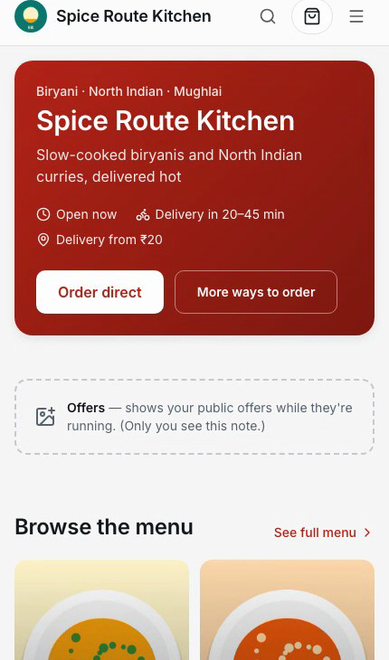
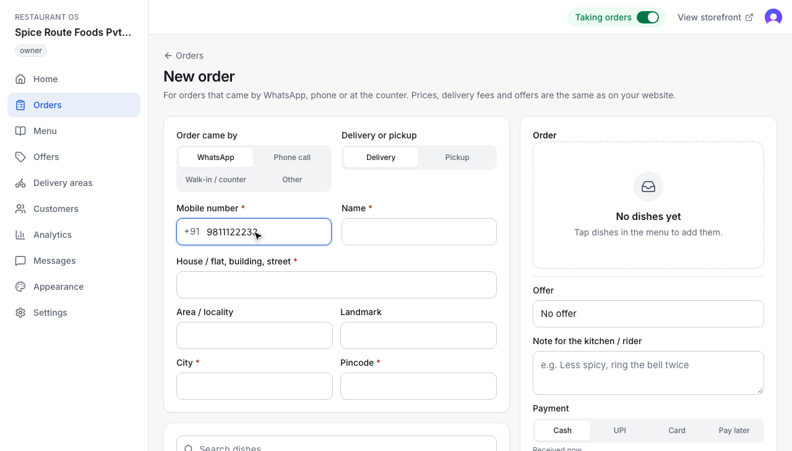
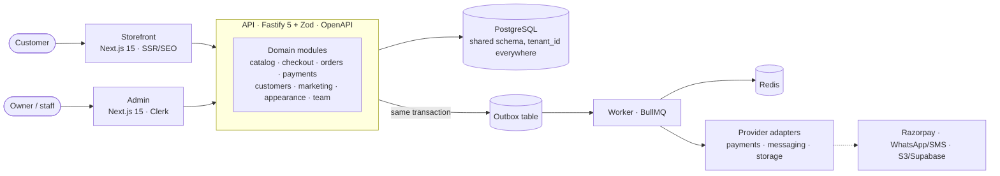

# Restaurant OS

**A multi-tenant ordering and operations platform for delivery-first restaurants.** Each restaurant gets its own SEO-ready storefront for direct orders (no aggregator commission) and an admin to run the business: order board, menu and stock, offers, delivery areas, customers, analytics and a no-code website designer. One deployment serves many restaurants; the pilot restaurant is a tenant, not a special code path.

[](https://github.com/nishitdixit/restaurant-os-ai-project/actions/workflows/ci.yml)


<table>
  <tr>
    <td width="34%"></td>
    <td></td>
  </tr>
  <tr>
    <td align="center"><sub>Storefront (customer, phone)</sub></td>
    <td align="center"><sub>Admin: staff enter WhatsApp / phone / walk-in orders, priced by the same engine as the website</sub></td>
  </tr>
</table>

## What it does

| For customers (storefront) | For the restaurant (admin) |
|---|---|
| Menu with categories, search, veg-only filter, dish options and add-ons | Live order board with sound alerts: accept, prepare, ready, dispatch, deliver, cancel, refund |
| Cart, coupons, delivery-area check by pincode or radius, minimum order | Menu, option groups, bulk stock on/off, photos, Hindi names |
| Checkout and payment, live order tracking, reorder | Offers (public, code-only, staff-only), with usage by channel and staff member |
| "Order on WhatsApp" with the cart prefilled | Staff-entered WhatsApp / phone / walk-in orders, pay later, mark paid |
| Server-rendered pages, JSON-LD, sitemap, share cards | Customers, analytics that reconcile with orders, messages, team roles, audit log |
| Per-restaurant look: 13 style presets and a homepage builder | Appearance editor with live preview, drafts, publish and restore, and a WCAG contrast guardrail that blocks unreadable themes |

## Architecture



A **modular monolith** (ADR-001): one API with a module per domain, shared pure domain logic in `packages/domain`, shared contracts in `packages/types` and a design system in `packages/ui`. Every architectural choice is recorded as an ADR in [`decisions/`](decisions/) (14 so far).

### Engineering decisions worth a look

- **Tenant isolation by construction** (ADR-002). Shared database, `tenant_id` on every row, tenant resolved server-side on every request, cross-tenant references rejected. Ten API tests cover reads, writes and cross-tenant IDs. A security review removed preview endpoints that accepted IDs without tenant checks, and a regression test keeps them unreachable.
- **Checkout that can't double-charge or double-create.** Pricing is server-authoritative. Order creation is idempotent per `Idempotency-Key`, tested with **5 concurrent identical requests**. Payment webhooks are signature-checked, replay-safe and amount-checked.
- **Transactional outbox** (ADR-009). Side effects (customer messages, payment-window expiry) are written to an outbox in the same transaction as the order. A worker relays them with `FOR UPDATE SKIP LOCKED`, and failed sends are retried with backoff and never duplicated.
- **Money in integer minor units** (ADR-005). There is no floating-point arithmetic on prices, taxes or discounts anywhere.
- **Provider adapters** (ADR-004). Payments, messaging and storage sit behind interfaces with contract tests. The pilot runs on mock providers by decision (ADR-010), and Razorpay is adapter-ready (ADR-007).
- **Explicit order lifecycle** (ADR-011). State transitions are validated, order snapshots are immutable, and a payment window expires unpaid orders.
- **Accessibility and readability are enforced, not hoped for.** axe checks run on customer pages in light and dark themes, and theme publishing is blocked while text contrast fails WCAG AA.

## Testing

| Layer | What | Count |
|---|---|---|
| Domain | Pure rules: pricing, promotions, delivery, theme contrast maths, preset distinctness, order messages | 69 |
| API integration | Real PostgreSQL (throwaway, migrated per run): checkout, idempotency, webhooks, tenancy, staff orders, appearance, resilience, payment-provider contracts | 94 |
| End to end | Playwright against API + worker + storefront on phone and desktop: customer journeys, 13 themes, accessibility (axe), WhatsApp ordering | 62 (last full run Oct 8) |
| Recorded walkthrough | `pnpm record` films admin and storefront side by side, asserts every flow, and writes a `BUGS.md` linking each failure to the video time, traces and server logs | 19 chapters |

CI runs typecheck, the domain and API suites against Postgres, a migration check on a fresh database, production builds and the end-to-end suite.

## Run it locally

Prerequisites: Node 22, pnpm 10 (`corepack enable`), PostgreSQL (local or Supabase), Redis (`docker compose up -d redis`) and a Clerk development application.

```sh
pnpm install
cp apps/api/.env.example apps/api/.env                 # DATABASE_URL, REDIS_URL, CLERK_SECRET_KEY
cp apps/storefront/.env.example apps/storefront/.env.local
cp apps/admin/.env.example apps/admin/.env.local       # Clerk publishable + secret key
pnpm db:setup                                          # migrations + pilot seed
pnpm dev                                               # API + worker :4000, storefront :3000, admin :3001
```

| Command | Purpose |
|---|---|
| `pnpm typecheck` | TypeScript across every package |
| `pnpm test` | Domain unit tests + API integration tests against a throwaway Postgres |
| `pnpm test:e2e` | Playwright customer journeys against a running stack |
| `pnpm build` | Production builds (API bundle, storefront, admin) |
| `pnpm record` | Recorded walkthrough of admin + storefront → `recordings/<date_time>/` (local only) |
| `pnpm demo:seed` | Reset the demo restaurant (menu with photos, customers, ~2 months of orders) |

API docs are served at `http://localhost:4000/docs`. Deployment (Vercel + Render + Supabase) and rollback: [`DEPLOYMENT_RUNBOOK.md`](DEPLOYMENT_RUNBOOK.md), [`engineering/RUNBOOK.md`](engineering/RUNBOOK.md).

## Repository layout

```text
apps/
  api/          Fastify API + BullMQ worker (modules per domain, provider integrations, jobs)
  storefront/   Next.js customer site (SSR, SEO, themes)
  admin/        Next.js restaurant admin (Clerk auth, role-based)
packages/
  domain/       pure business rules shared by API and UI
  types/        shared contracts
  ui/           design system
db/             SQL migrations (0001-0010, additive) and seeds
tests/          e2e (Playwright) and the recorded walkthrough harness
decisions/      architecture decision records
docs/           product, domain, architecture, security and tenancy docs
```

## How it was built

Restaurant OS is built with an AI-assisted, spec-driven workflow: product vision → PRD → domain model and business rules → ADRs → feature specs → tasks → code, with each layer the source of truth for the one below. The agent-facing entry points are [`AI_START_HERE.md`](AI_START_HERE.md) and [`docs/REPOSITORY_GUIDE.md`](docs/REPOSITORY_GUIDE.md). Business rules that need the owner's sign-off are tracked explicitly in [`docs/BUSINESS_RULES.md`](docs/BUSINESS_RULES.md), and current progress is in [`BUILD_STATE.md`](BUILD_STATE.md).

## Status

Pilot MVP: feature-complete and pending pilot acceptance. Payments and customer messages run on development providers for the pilot (ADR-010). Next: the Razorpay sandbox run, a real messaging provider, and the V1 roadmap (kitchen display, inventory, aggregator sync) in [`roadmap/`](roadmap/).
